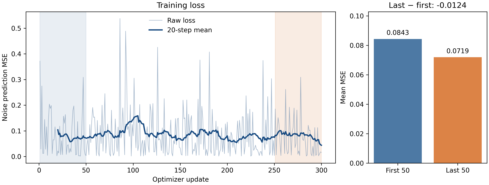
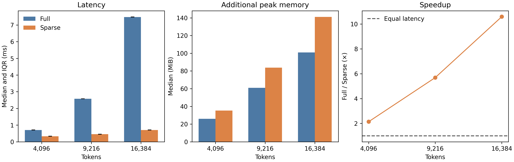
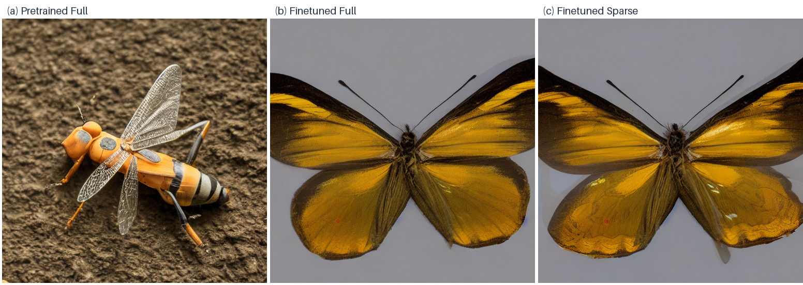

# Stable Diffusion 1.5 微调与单层窗口注意力

这是我的大模型课程实验。我先用固定的 32 张蝴蝶图片微调 Stable Diffusion 1.5 的整个 UNet，观察模型预测噪声的误差和生成结果。接着在微调后的模型里，只将指定的一层自注意力换成 16×16 的非重叠窗口，比较它和原有 Full Attention 的耗时、显存和出图效果。

为什么用了这些参数、实验时遇到了什么、以及结果该怎么理解，见[实验笔记](EXPERIMENT_NOTES.md)。

## 实验结果

正式训练跑了 300 步。前 50 步的平均 loss 为 **0.08431**，后 50 步为 **0.07189**，下降 **14.73%**。图中保留每一步的读数和 20 步滑动平均。



在首个 DDIM 步捕获真实输入后，我单独回放同一层。表中为每种方法 30 次测量的中位数。

| 图像分辨率 | 目标层 tokens | Full / Sparse 耗时（ms） | 单层加速 | Full / Sparse 新增峰值显存（MiB） |
|---|---:|---:|---:|---:|
| 512×512 | 4,096 | 0.708 / 0.331 | 2.14× | 26.00 / 35.25 |
| 768×768 | 9,216 | 2.579 / 0.453 | 5.69× | 61.00 / 83.81 |
| 1024×1024 | 16,384 | 7.478 / 0.706 | 10.59× | 101.00 / 141.00 |



[训练原始 loss](results/training_loss_raw.csv) · [180 条性能读数](results/benchmark_raw.csv) · [数值校验](results/qualify.csv)



从左到右是预训练 Full、微调后 Full、微调后 Sparse。后两张还共用同一份微调权重。

## 怎么重跑

### 环境

使用独立的 Python 3.10.14 环境。下面是在新克隆的仓库中安装的步骤。两档程序都会读取 `environment-lock.txt` 并记录它的 SHA256，因此在仓库根目录用当前环境生成它。原实验目录中已有的锁文件留作当时的运行记录。

```bash
conda create -n sd-window-lab python=3.10.14 -y
conda activate sd-window-lab
python -m pip install torch==2.4.1 torchvision==0.19.1 --index-url https://download.pytorch.org/whl/cu121
python -m pip install -r requirements.txt
python -m pip check
python -m pip freeze > environment-lock.txt
```

### 模型和数据

[资源清单](asset-manifest.json)记录了模型、数据、下载路径和 SHA256。下面的命令按清单下载固定的 Diffusers 模型文件和 Parquet，下载后可按清单核对文件。脚本会把数据导出到 `data/butterflies/`；`cmp` 用来核对这次生成的数据清单和原实验是否一致。

```bash
python - <<'PY'
import json
from pathlib import Path
from huggingface_hub import hf_hub_download, snapshot_download

assets = json.loads(Path("asset-manifest.json").read_text())
prefix = "models/sd15/"
model_files = [f["path"].removeprefix(prefix) for f in assets["files"]
               if f["path"].startswith(prefix)]
snapshot_download(repo_id=assets["model_repo"], revision=assets["model_revision"],
                  allow_patterns=model_files, local_dir="models/sd15")
hf_hub_download(repo_id=assets["dataset_repo"], revision=assets["dataset_revision"],
                repo_type="dataset", filename="data/train-00000-of-00001.parquet",
                local_dir="data/raw")
PY
python prepare_dataset.py
cmp dataset-manifest.json data/butterflies/manifest.json
```

### 训练、生成和测量

以下命令在干净的运行目录中执行。把 `CUDA_VISIBLE_DEVICES` 设为一张可用卡的编号。重复实验时换一组新的输出目录。

```bash
export CUDA_VISIBLE_DEVICES=0
BASE=runs/baseline-001
MODEL=outputs/sd-butterflies
ADV=runs/sparse-001

python baseline.py infer --latents "$BASE/images/initial_latents.safetensors" \
  --output "$BASE/images/pretrained_full.png"
python baseline.py train --run-dir "$BASE/train" --output-dir "$MODEL"
python baseline.py infer --model "$MODEL" --latents "$BASE/images/initial_latents.safetensors" \
  --output "$BASE/images/finetuned_full.png"
python baseline.py plot --csv "$BASE/train/train_steps.csv" --output-dir "$BASE/figures"

python sparse_trial.py capture --baseline-run "$BASE" --run-dir "$ADV"
python sparse_trial.py qualify --run-dir "$ADV"
python sparse_trial.py benchmark --run-dir "$ADV"
python sparse_trial.py generate --run-dir "$ADV"
python sparse_trial.py plot --run-dir "$ADV"
```

只想从已保存的 loss 重画训练曲线，可以在 CPU 上运行 `python baseline.py plot --csv results/training_loss_raw.csv --output-dir runs/replot-loss`。

## 归档范围与来源

仓库保留脚本、[样本清单](dataset-manifest.json)和精选结果。完整模型、数据集图片、捕获张量和课程报告单独归档。重训可以复现流程，权重和计时可能随执行环境变化。[正式训练摘要](results/training_summary.json)保留了当时的 UNet SHA256。

参考了 [Diffusers v0.30.3 的标准训练示例](https://github.com/huggingface/diffusers/blob/c9ff360966327ace3faad3807dc871a4e5447501/examples/text_to_image/train_text_to_image.py)，使用 [Stable Diffusion 1.5](https://huggingface.co/stable-diffusion-v1-5/stable-diffusion-v1-5)、[Smithsonian 蝴蝶子集](https://huggingface.co/datasets/huggan/smithsonian_butterflies_subset)和 PyTorch SDPA。实现、排错及文档整理使用了 Codex 辅助。
